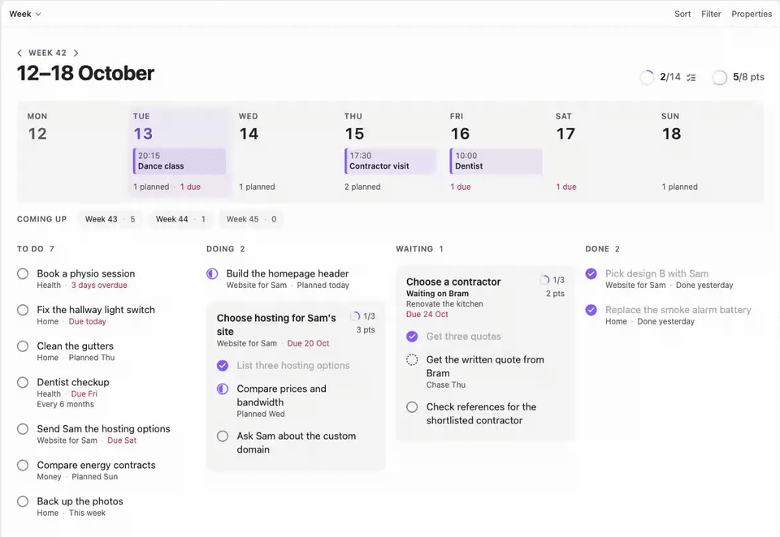
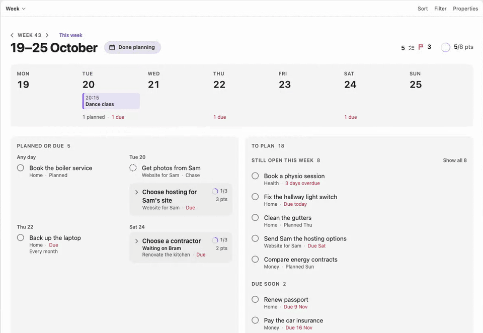
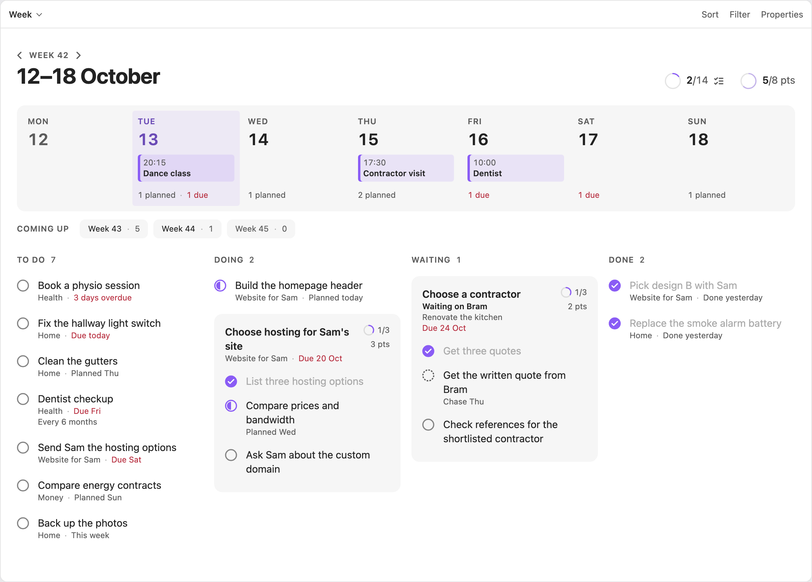
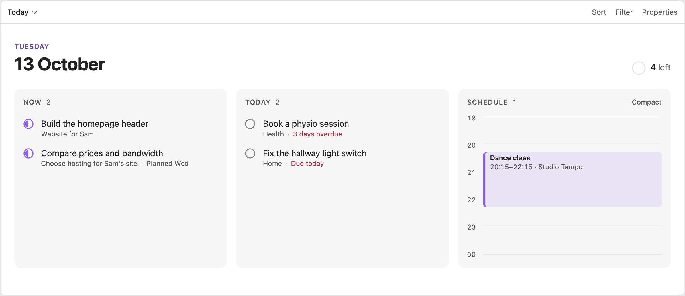
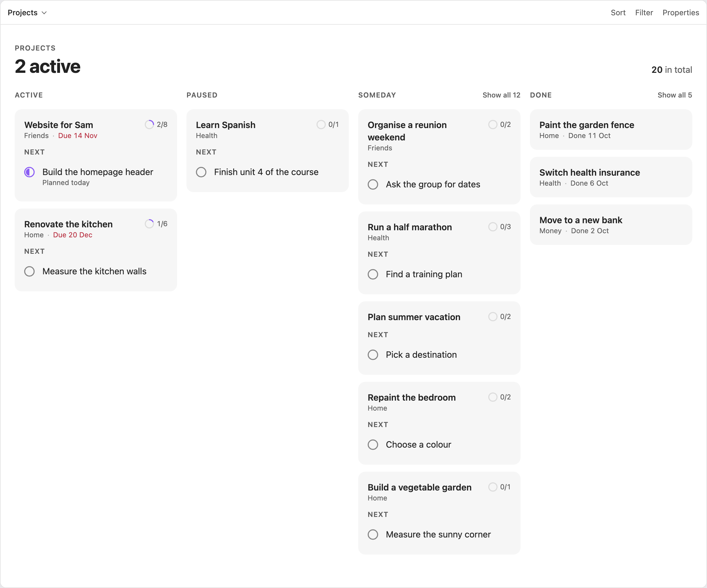
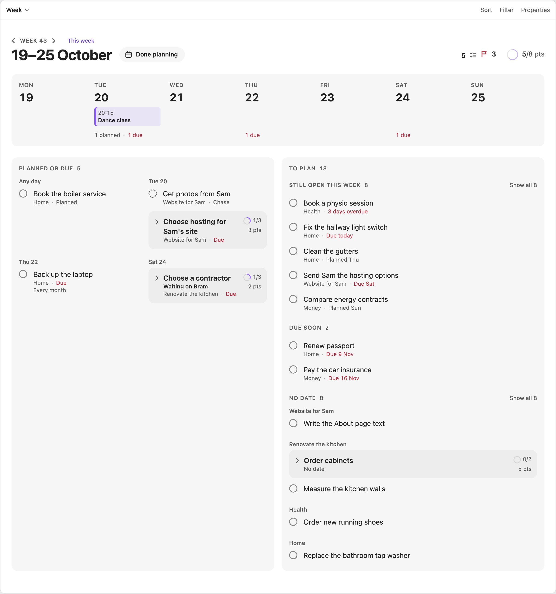
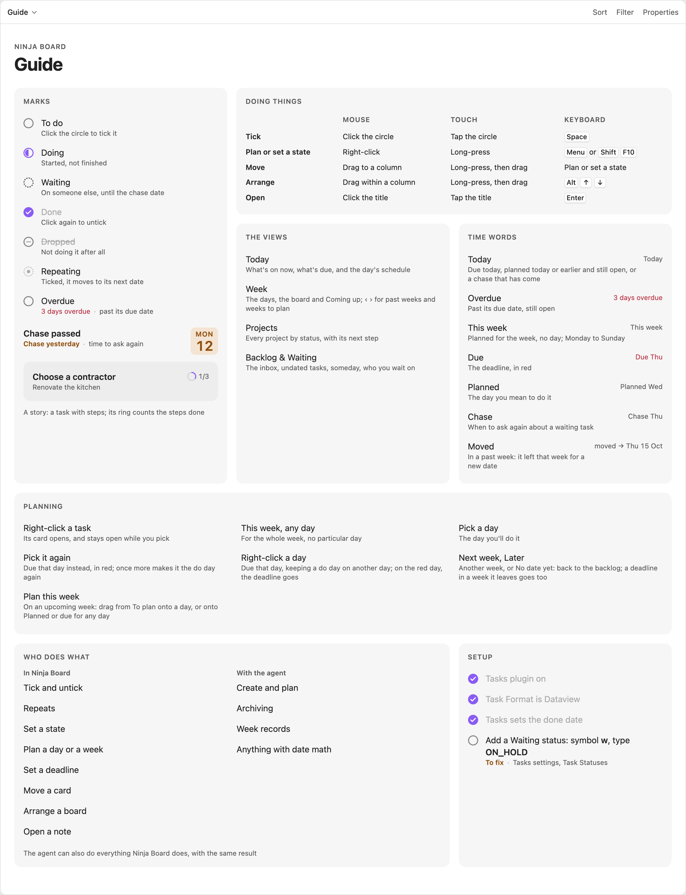

# Ninja Board

Ninja Board is an Obsidian plugin that shows your notes as five boards: Today, Week, Projects, Backlog & Waiting, and a Guide. It is for people who keep tasks, projects and appointments as plain notes and want to see and plan them the way a good app would.



*Drag a card to another column, and the note changes with it.*



*Drop a task on a day in the Week strip to plan it.*

## What it does

- Adds five views to Bases, Obsidian's core plugin for views over notes. Bases picks the notes, and Ninja Board draws them.
- In a view you can tick a task, set its state, drag a card to another column, plan a task for a day or a week, set a deadline, arrange a board, and open the note behind anything.
- It keeps no data of its own and uses no network. Every change is one small edit to one note, so a view always matches your vault. Even a board's order is saved in its dashboard note.

It works with any vault laid out like the [sample vault](sample-vault/): notes with a `type` in their frontmatter, task lines in the Tasks plugin's Dataview format, and the dashboard notes in `01 Dashboard/`. The full note format is in [Database](docs/DATABASE.md).

## Requirements

- Obsidian 1.10.2 or newer. Ninja Board uses the Bases view API, which arrived in 1.10.0. Ninja Board is tested on desktop. It is not marked desktop-only, but the phone app has not been tried.
- The Bases core plugin, turned on. Without it, Ninja Board shows a Notice and adds no views.
- The [Tasks](https://github.com/obsidian-tasks-group/obsidian-tasks) community plugin, set up as in [Set up Tasks](#set-up-tasks).

## Install

Ninja Board is not in Obsidian's community plugin browser yet. Install it by hand or with BRAT.

**By hand:**

1. Download `main.js`, `manifest.json` and `styles.css` from the [latest release](https://github.com/AlexSendula/ninja-board/releases/latest).
2. Put them in `<your vault>/.obsidian/plugins/ninja-board/`.
3. Reload Obsidian, then turn on Ninja Board under Settings → Community plugins.

**With BRAT:**

1. Install [BRAT](https://github.com/TfTHacker/obsidian42-brat) from the community plugin browser.
2. In BRAT's settings, choose **Add beta plugin** and enter `https://github.com/AlexSendula/ninja-board`.
3. Turn on Ninja Board under Settings → Community plugins.

**For a new vault**, [Second Brain Setup](https://github.com/AlexSendula/second-brain-setup) installs Ninja Board, Tasks (already set up) and the dashboard notes for you.

## Set up Tasks

Do this once, in Obsidian's settings:

1. Under Tasks → Task Format, choose **Dataview**.
2. Under Tasks → Task Statuses, add a custom status: symbol `w`, name `Waiting`, next status symbol `x`, status type `ON_HOLD`.
3. Leave **Set done date on every completed task** on. It is on by default.

The Guide's **Setup** tile checks this for you. The [user guide](docs/USER_GUIDE.md#the-tasks-setup-check) says what it checks. The Guide reads whether Tasks is on, and Tasks' saved settings, to check the setup, and nothing else.

## Add the dashboards

Each view lives in a dashboard note. Copy the five notes from [`sample-vault/01 Dashboard/`](sample-vault/01%20Dashboard/) into a `01 Dashboard/` folder in your vault. Each one holds a single `base` block, like Today's:

```base
filters:
  and:
    - '!file.inFolder("10 Archive")'
    - 'file.ext == "md"'
views:
  - type: ninja-board-today
    name: Today
```

The others use `ninja-board-week`, `ninja-board-projects`, `ninja-board-backlog` and `ninja-board-guide`. To open on Today, set it under Settings → Files and links → Default file to open.

## Try the sample vault

[`sample-vault/`](sample-vault/) is a small vault with the dashboards and invented notes. Copy its contents into an empty folder, open that folder as a vault, then install Tasks and Ninja Board as above.

## Use it

- **Tick** a task: click its circle, or press Space.
- **Plan, set a deadline or change a state:** right-click a row or card (long-press on touch, or Shift+F10) to open its card.
- **Move** a task or project: drag it to another column, or onto a day of the Week strip to plan it.
- **Arrange** a board: drag a card within its column, or press Alt+↑ and Alt+↓.
- **Open** the note: click the title, or press Enter.
- **Undo:** Cmd/Ctrl+Z in a view, or the command **Undo the last change**.

The [user guide](docs/USER_GUIDE.md) covers each view, planning a week, the cards, repeats and the exact edits Ninja Board makes. If something doesn't show, see [Troubleshooting](docs/TROUBLESHOOTING.md).

## Screenshots

<p align="center">
  <br>
  <sub>Week</sub>
</p>

<table>
  <tr>
    <td align="center" width="50%"><br><sub>Today</sub></td>
    <td align="center" width="50%"><br><sub>Projects</sub></td>
  </tr>
  <tr>
    <td align="center" width="50%"><br><sub>Planning a task</sub></td>
    <td align="center" width="50%"><br><sub>Guide</sub></td>
  </tr>
</table>

## Update

Replace the three files with the ones from the new release, then reload Obsidian. BRAT can do this for you.

## Developing

You need Node 24 or newer. From this folder:

```bash
npm install
npm run build
```

`npm run build` writes `main.js`. With `manifest.json` and `styles.css`, that is the whole plugin. Reload Obsidian after each new build.

- `npm test` runs the tests.
- `npm run lint` checks the code with ESLint and Obsidian's review rules. It must report nothing.
- `npm run typecheck` checks the types.
- `npm run dev` rebuilds `main.js` on every change.
- `npm run preview` shows the real views on the sample vault, at http://localhost:8766/preview/.
- `npm run sandbox` (macOS only) builds and copies the plugin into the vault named by `BRAIN_VAULT` (by default `~/Documents/Obsidian Vault`). The vault must already have a `.obsidian` folder, or the script stops. `npm run sandbox -- --yes` also moves that vault's notes to the Trash and copies in the sample vault.

Releases are built by pushing a tag equal to the manifest's version, for example `1.0.1`. The [release workflow](.github/workflows/release.yml) then lints, tests, builds and attests the three files.

More in the [developer guide](docs/DEVELOPER.md).

## Part of Second Brain

- [Second Brain](https://alexsendula.github.io/second-brain/): the framework, with its design and research
- [Ninja Board](https://github.com/AlexSendula/ninja-board): the Obsidian plugin that shows the vault as boards
- [Second Brain Setup](https://github.com/AlexSendula/second-brain-setup): sets up a vault from one sentence to your agent

## Licence

MIT, Copyright (c) 2026 AlexSendula. See [LICENSE](LICENSE).
