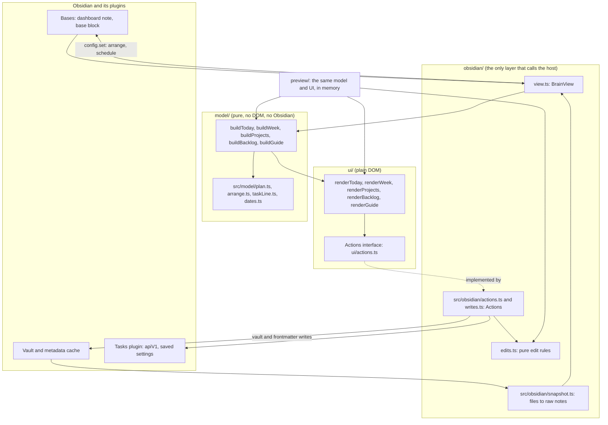
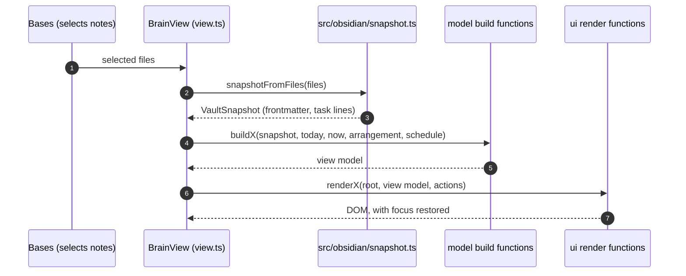
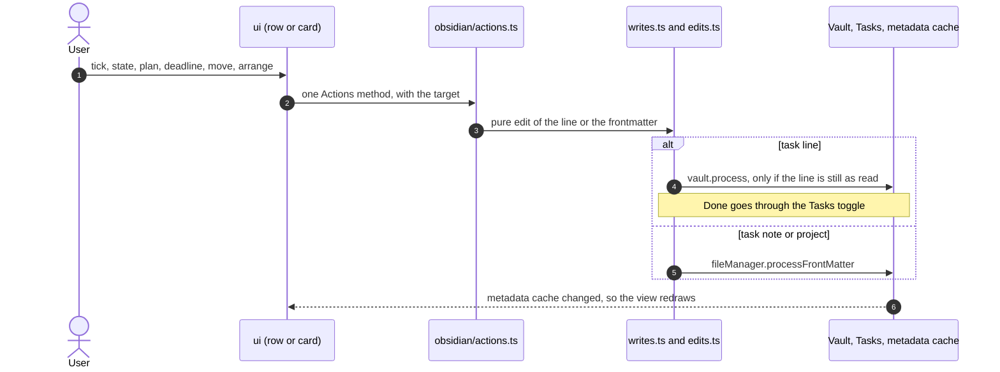
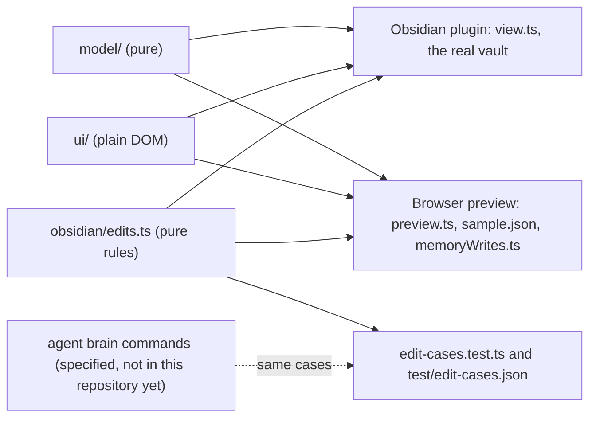

# Architecture

> Last updated: 17 October 2026 (Ninja Board v1.0.2)

## Overview

Ninja Board is an Obsidian plugin in this repository. It draws five views over the notes that a Bases view selects: Today, Week, Projects, Backlog & Waiting, and Guide. A user ticks tasks, sets states, plans, sets deadlines, moves cards, arranges boards and opens notes from them.

Ninja Board keeps no data of its own. Each change is one small edit to one note, written straight back to the vault, so a view cannot drift from the vault. The agent makes the same edits through `brain` commands. Both sides are meant to pass one set of examples. Only Ninja Board's side is tested in this repository so far (see [API.md](API.md#edit-contract-shared-with-the-agent)).

Versions: v0.1.0 was built on 14 October 2026 (round 1), and v0.2.0 on 15 October 2026 (round 2, with busy days added the same day), v1.0.0 on 16 October 2026, v1.0.1 on 17 October 2026 (the Obsidian review fixes), and v1.0.2 on 17 October 2026 (the last review warnings). Obsidian 1.10.2 or newer is required, because that release added the Bases view API ([`manifest.json`](../manifest.json), [`versions.json`](../versions.json)).

Specs and design: [plugin design](design/2026-10-13-brain-plugin-design.md), [round 2](design/2026-10-14-brain-plugin-round-2-design.md), and the user's guide in [`README.md`](../README.md).

## Diagrams

### Layers

Arrows show what calls what. Only `obsidian/` (and the entry point `main.ts`) calls Obsidian.

### Drawing a view (read path)

### Making a change (write path)

Arrangements and the Schedule's form are not written by `Actions` to the note directly. They go through the view's config, and Bases writes the dashboard note's base block.

Every write is also a step in the undo history. The pure history, `src/model/history.ts`, keeps the steps and their groups. `src/obsidian/undo.ts` binds it to the vault: each write records its before and after, and Undo restores a step through the same writers, only where the note or the view still holds what Ninja Board wrote.

### Preview and the shared code

## The layers

### Model: `src/model`

Pure TypeScript with no DOM and no Obsidian imports. It takes the vault as a `VaultSnapshot` and the date and time as arguments, and returns view models ([`types.ts`](../src/model/types.ts) defines both). Tests run under Node's test runner.

### UI: `src/ui`

Plain DOM, built with `h()` ([`dom.ts`](../src/ui/dom.ts)). Renderers take a view model and an `Actions` object. The UI reaches the outside only through `Actions` ([`src/ui/actions.ts`](../src/ui/actions.ts)) and the DOM. It also imports pure helpers from the model (dates, plan rules, arrangement placement). The time of day comes in as `"HH:MM"` ([`clock.ts`](../src/ui/clock.ts)). Tests use linkedom.

### Obsidian: `src/obsidian`

Everything that touches Obsidian or the Tasks plugin: the Bases view, reading the selected notes, the `Actions` implementation, the writes, and the two modals. The exception is [`edits.ts`](../src/obsidian/edits.ts). It holds the pure edit rules and does not import `obsidian` at all, so Node's tests and the preview can load it.

The entry point [`main.ts`](../src/main.ts) also imports `obsidian`. It registers the five view types (`VIEWS`, line 10), the three commands (Open today, Open guide and Undo the last change), and the undo key on each window's document.

### Preview: `preview`

A browser page that runs the same model and UI on `preview/sample.json`, generated from `sample-vault/` by [`scripts/sample-json.mjs`](../scripts/sample-json.mjs). Writes change the notes in memory only ([`memoryWrites.ts`](../preview/memoryWrites.ts)), and they use the same pure edit rules as the plugin. The clock is fixed at 13 October 2026, 11:10 ([`preview.ts`](../preview/preview.ts)), so the screen reads the same on every visit. It is for checking the design in light and dark at each width, and runs at `npm run preview`. [`preview/obsidian-dom.ts`](../preview/obsidian-dom.ts) installs the Obsidian helpers the views call on every element (`createEl`, `setCssProps`, `setCssStyles`), for the preview and the tests.

## Data flow

### Reading

1. **Bases selects the notes.** The dashboard note's `base` block sets the filter, for example "not in `10 Archive`". Bases hands the view the selected files. Ninja Board ignores Bases' grouping and sorting and keeps its own order ([`README.md`](../README.md), Dashboard notes).
2. **The snapshot is built.** [`snapshotFromFiles`](../src/obsidian/snapshot.ts) drops anything under `10 Archive/`, sorts by path, takes frontmatter from the metadata cache, and reads the file only when the cache lists a task in it. [`buildSnapshot`](../src/model/snapshot.ts) (line 11) parses the lines into `TaskLine`s, using Tasks' Dataview format ([`taskLine.ts`](../src/model/taskLine.ts)).
3. **Extra reads, only where needed.** A past week reads its plan note, `08 Weeks/<year>/<YYYY-Www>.md`, for its record ([`readWeekPlan`](../src/obsidian/snapshot.ts)). The Guide reads no notes. It reads the Tasks plugin's saved settings for its setup check ([`readTasksSetup`](../src/obsidian/edits.ts), line 129).
4. **The model builds a view model.** `DRAW` ([`view.ts`](../src/obsidian/view.ts), line 42) calls the builder for the view's type. It passes the snapshot, `today` and `now` (both from [`writes.ts`](../src/obsidian/writes.ts)), the `arrange:` lists, and the Schedule's form. The model never reads the clock.
5. **The UI renders it.** The renderer builds the DOM from the view model and the `Actions` object. The view restores keyboard focus and the pager's focus after the redraw ([`focus.ts`](../src/ui/focus.ts)). Only the newest render draws, so a slow read cannot overwrite a newer one ([`view.ts`](../src/obsidian/view.ts), `render`, line 214).

### Changing

6. **An interaction calls one `Actions` method.** For example, `plan(target, to)` for a planner pick, or `setState` for a state pick.
7. **The write is one small edit.** [`obsidianActions`](../src/obsidian/actions.ts) (line 15) calls [`writes.ts`](../src/obsidian/writes.ts).
   - Task lines: `vault.process` replaces the line only if it still reads as it did when drawn ([`replaceLineIfUnchanged`](../src/obsidian/edits.ts), line 42). Otherwise the write is refused and a Notice says the task changed. Ticking done goes through Tasks' toggle ([`toggleViaTasks`](../src/obsidian/writes.ts), line 26).
   - Task notes and projects: `fileManager.processFrontMatter`, with the pure rules from [`src/model/plan.ts`](../src/model/plan.ts) and [`edits.ts`](../src/obsidian/edits.ts).
   - Story points: `points` writes only a story. [`isStoryFile`](../src/obsidian/snapshot.ts) decides it from the note and the folders above it, reading frontmatter from the metadata cache. It never lists the vault's files.
   - Arrangements and the Schedule's form: the view's config, which Bases writes into the dashboard note.
8. **The vault reports back.** A metadata cache change to a shown note, or Bases' data update, calls `rerender`. That runs 150 ms after the last call ([`view.ts`](../src/obsidian/view.ts), line 74). The view also redraws at midnight, when a Week strip changes, and every minute to move the now-line ([`view.ts`](../src/obsidian/view.ts), lines 164 to 175).

Session state lives in memory and ends when the view closes: the week shown, the Schedule's form when the config could not hold it, and the day of the last render ([`view.ts`](../src/obsidian/view.ts), lines 61 to 72). A view always opens on this week.

## Modules by layer

### Model (`src/model`)

| Module | Role |
|---|---|
| `types.ts` | Shared types: `VaultSnapshot`, `NoteInfo`, `TaskLine`, `RowTarget`, `PlanTo`, and every view model. |
| `src/model/snapshot.ts` | Raw notes to a `VaultSnapshot`. Projects and areas own their notes by folder. |
| `taskLine.ts` | Parses Tasks' Dataview task lines and rewrites their symbol and fields. |
| `dates.ts` | ISO weeks (Monday to Sunday) and the date words: "Due Thu", "3 days overdue". |
| `rows.ts`, `order.ts` | Task rows (`lineRow`, `noteRow`), and the ordering helpers the builders share. |
| `src/model/today.ts`, `appointments.ts` | The Today view, and the appointments of a day (dated ones and weekly repeats). |
| `src/model/week.ts`, `upcoming.ts`, `src/model/past.ts`, `record.ts` | The Week view: this week, the upcoming weeks (Coming up, To plan), and past weeks from the record or the notes. `weekPlanPath` names the plan note. |
| `src/model/projects.ts`, `src/model/backlog.ts` | The Projects board, and Backlog & Waiting. |
| `src/model/plan.ts` | Planning and deadline rules: `planDropsDue`, `applyNotePlan`, `applyNoteDue`, and the planner card's day and week logic (`pickDay`, `pickWeek`, `pickNoDate`). |
| `arrange.ts` | Reads and merges `arrange:`, builds item keys (`lineKey`), and orders items (`arrange`, `placeItem`). Reads `schedule:`. |
| `src/model/guide.ts` | The Guide's setup check, from the Tasks settings Ninja Board could read. |
| `src/model/history.ts`, `undoLabel.ts` | The undo history, with no Obsidian in it: the steps, their groups and the queue, and the names a step is shown by. |
| `src/model/points.ts` | Story points: the values, the week's target (`targetOf`), a story's points edit (`applyNotePoints`) and a week's points (`pointsOfWeek`). |

### UI (`src/ui`)

| Module | Role |
|---|---|
| `dom.ts` | The `h()` element builder, plus `svg` and `link`. |
| `src/ui/actions.ts` | The `Actions` interface, and the `ListSpec` and `DaySpec` shapes. |
| `src/ui/today.ts`, `src/ui/week.ts`, `src/ui/projects.ts`, `src/ui/backlog.ts`, `src/ui/guide.ts` | One renderer per view. |
| `strip.ts`, `schedule.ts`, `day.ts` | The Week strip, Today's Schedule (Large and Compact, with `tickNow`), and a day's full timeline. |
| `task.ts`, `card.ts`, `marks.ts` | Task rows and their item menu, story and project cards, and the marks and rings. |
| `popover.ts` | The cards: planner, states, story and project (`openCard`, `closeCard`). |
| `src/ui/plan.ts` | The To plan and Planned or due lists on an upcoming week, and their drops. |
| `src/ui/past.ts` | The read-only board of a past week. |
| `drag.ts` | Press, drag, edge auto-scroll and long-press between columns, days, weeks and To plan. Slots and `DropTarget`. `cancelDrags` ends the drags in progress when a view unloads. |
| `host.ts` | Marks the notes and embeds a view sits in (`brain-note-host` and `brain-embed-host`), at any depth, so the CSS can hide a dashboard note's Properties and Bases toolbar without `:has`. A view's unload clears a mark once no other live view is in its host. |
| `src/ui/listModal.ts` | The body of the Show all list, shared with the modal. |
| `focus.ts`, `header.ts`, `page.ts`, `clock.ts` | Focus across redraws, the view head with its pager, the page and its folding tiles, and the time helpers (`minutes`, `hasEnded`, `nextChange`, `wakeAt`). |

### Obsidian (`src/obsidian`)

| Module | Role |
|---|---|
| `view.ts` | `BrainView`, a `BasesView`. One class serves all five view types. It draws, re-renders, and owns the view config (`arrange`, `schedule`). |
| `src/obsidian/snapshot.ts` | Reads the selected notes, and a past week's plan note. `isStoryFile` is the story check: it reads one note's folders, not the vault. |
| `src/obsidian/actions.ts` | `obsidianActions`: the `Actions` the views call. A failed write becomes a Notice, never an unhandled error. |
| `writes.ts` | `today()` and `now()`, the line and frontmatter writes, and the Tasks toggle. |
| `edits.ts` | The pure edit rules (`lineWithState`, `lineWithPlan`, `lineWithDue`, `applyNoteStatus`), the Tasks API check, `arrangementPersists`, and `readTasksSetup`. |
| `src/obsidian/listModal.ts`, `dayModal.ts` | The Show all list and the day's timeline, as Obsidian `Modal`s. |
| `src/obsidian/guide.ts` | `openGuide`: opens `01 Dashboard/05 Guide.md`, or says it is missing. |
| `src/obsidian/undo.ts` | `undoLast` and the restore. Each write is checked against the note or view as it is now, and a step that fails a check is skipped with the Notice "Changed since: not undone". |

### Tests and build

`npm test` runs every `src/**/*.test.ts` and `test/**/*.test.ts` with Node's test runner, with TypeScript types stripped at run time. `test/sample.ts` loads `sample-vault/` as raw notes. `test/edit-cases.json` holds the shared edit examples. The script loads `test/obsidian-hook.mjs` first, which puts `test/obsidian-stub.ts` in place of the `obsidian` package, so the modules that import it run under Node. `test/nodes.test.ts` fails when an assertion compares a DOM node. `test/styles.test.ts` checks `styles.css` against the mockup's `#brain-css` block. The two differences allowed are the scoping under `.brain-view` and one reset. The build is [`esbuild.config.mjs`](../esbuild.config.mjs): it bundles `main.js` as CommonJS and leaves `obsidian` and the editor packages external. [`scripts/sandbox.mjs`](../scripts/sandbox.mjs) installs the build into the sandbox vault. `npm run lint` runs ESLint with Obsidian's review rules over `src` and `preview`.

## Key design decisions

| Decision | Rationale | Alternatives considered |
|---|---|---|
| No data of its own. Views draw the vault, and every change is one edit to one note. | "A view can never drift from the vault" ([plugin README](../README.md)). | One note per task, as TaskNotes does. The research rejected it as "the wrong model here" ([research, 13 October 2026](https://alexsendula.github.io/second-brain/research/2026-10-13-obsidian-plugins/)). |
| Bases selects and filters the notes; Ninja Board draws them. | Bases already selects notes in a dashboard note. Ninja Board adds the views ([plugin design, section 2](design/2026-10-13-brain-plugin-design.md)). | Bases kanban, which shows notes only, not checkbox lines. Tasks queries, whose lists "look plain and can't show a story's tasks on a board card" ([implementation spec, section 1](https://alexsendula.github.io/second-brain/implementation/)). |
| Ticking a task goes through the Tasks plugin's toggle. | "One completion engine, wherever you tick from" ([plugin design, section 2](design/2026-10-13-brain-plugin-design.md)). For dropped, Ninja Board writes the cancelled date itself. | Not recorded. |
| The plugin and the agent make the same edits, with the same result. | "Anything you can do in the plugin, the agent can do with the same result" ([implementation spec, section 1](https://alexsendula.github.io/second-brain/implementation/)). Both sides are pinned by `test/edit-cases.json`. | Not recorded. |
| Arrangement is saved in the dashboard note's base block, as `arrange:`. Nothing is written to task notes. | Layout only: "a position means just arrangement, not priority" ([round 2, section 1](design/2026-10-14-brain-plugin-round-2-design.md)). | Writing the position into task notes, which round 2 ruled out ([round 2, section 3](design/2026-10-14-brain-plugin-round-2-design.md)). |
| The order of an arrangement has no meaning beyond layout. | Only the board reads it. Today, Projects' Next and the agent do not ([round 2, section 3](design/2026-10-14-brain-plugin-round-2-design.md)). | A priority order, which the author did not ask for. |
| Today and the time of day are passed in. The model never reads the clock. | Keeps the model and the UI pure and testable. The preview fixes the clock. The code says so at [`clock.ts`](../src/ui/clock.ts) and [`view.ts`](../src/obsidian/view.ts) (line 32). | Not recorded. |
| Ninja Board does little date math: filtering and words, plus the one next-date step a repeating task note takes when an occurrence is completed. Carry-over and other repeats belong elsewhere. | The [plugin README](../README.md) section "Ninja Board does little date math": its one step is a repeating task note's next due date, when an occurrence is completed. | Ninja Board computing other dates, such as carry-over or task-line repeats, which the README rules out. |
| Past weeks are read from the agent's frozen record. Without one, they come from the notes. | The record freezes what was true at the week's turn. Ninja Board only reads it ([round 2, section 5](design/2026-10-14-brain-plugin-round-2-design.md), and the [implementation spec, section 1](https://alexsendula.github.io/second-brain/implementation/)). The notes are the fallback ([round 2, section 4](design/2026-10-14-brain-plugin-round-2-design.md)). | Not recorded. |
| Cards replace Obsidian's status menu. | Round 2 added the planner card, and the states, story, project and repeat cards. The planner card is in [round 2, section 4](design/2026-10-14-brain-plugin-round-2-design.md). | Obsidian's own `Menu`, in the first design ([plugin design, section 2](design/2026-10-13-brain-plugin-design.md)). |
| The edit rules are pure functions, shared by the plugin, the preview and the tests. | One set of rules, so the preview and the tests run the code the plugin runs. | Not recorded. |
| Undo is one history in the obsidian layer, and a step goes back only where nothing changed since. | Every write passes through one place, so none is left out of the history. A restore uses the same writers and the same stale guard as an edit ([undo design, sections 3 to 6](design/2026-10-15-brain-undo-design.md)). | Restoring snapshots of the DOM, as the mockup's demo does. The plugin restores notes and layouts, not pictures of the screen (undo design, section 6). |
| Styles are classes, and a run-time value goes through the Obsidian helpers. `styles.css` uses no `:has`. | Obsidian's review rules flag inline style writes, `:has` and `!important`; iOS before 16.4 has no lookbehind ([styles test](../test/styles.test.ts)). | Inline style writes from the views, which the review flags. |
| No runtime dependencies. Only Obsidian's and Tasks' APIs are used. The plugin is mobile-safe. | The phone app has no Node or Electron APIs, so `isDesktopOnly` is `false` ([plugin design, section 2](design/2026-10-13-brain-plugin-design.md)). `package.json` lists only dev dependencies. | Not recorded. |

## External dependencies

| Dependency | Purpose | Version | Documentation |
|---|---|---|---|
| Obsidian (`obsidian` package) | Views (`registerBasesView`), commands, modals, file writes | Built against 1.14.4. Requires 1.10.2 or newer ([`manifest.json`](../manifest.json)). | Type declarations in `node_modules/obsidian`. |
| Bases core plugin | Selects the notes and hosts the five views. Ninja Board shows a Notice without it. | Core, must be on | [research, Bases section](https://alexsendula.github.io/second-brain/research/2026-10-13-obsidian-plugins/) |
| Tasks community plugin (`obsidian-tasks-plugin`) | Ticking (`apiV1.executeToggleTaskDoneCommand`), and its saved settings for the Guide's check. Ninja Board needs its Dataview format and a custom `w` status (ON_HOLD). | Not pinned by Ninja Board. The research recorded 8.5.0, released 10 October 2026. | [research, candidates table](https://alexsendula.github.io/second-brain/research/2026-10-13-obsidian-plugins/) |
| Node.js | Runs the tests and scripts directly, with type stripping. Only needed to build. | 24 or newer (`engines` in [`package.json`](../package.json)) | |
| esbuild | Bundles `main.js` and the preview | 0.28.2 | [`esbuild.config.mjs`](../esbuild.config.mjs) |
| TypeScript | Type check (`npm run typecheck`) | 5.9.3 | |
| linkedom | A DOM for the UI tests | 0.18.13 | |
| yaml | Reads the sample vault's frontmatter in tests | 2.9.1 | |
| @types/node | Node types | 24.19.2 | |

## Related documentation

- [API reference](API.md): the views, commands, dashboard note format, `Actions` and the edit contract.
- [Plugin README](../README.md): what the user sees and does.
- [Plugin design](design/2026-10-13-brain-plugin-design.md) and [round 2 design](design/2026-10-14-brain-plugin-round-2-design.md).
- [Implementation spec](https://alexsendula.github.io/second-brain/implementation/): the agent side, and the Edits table.
