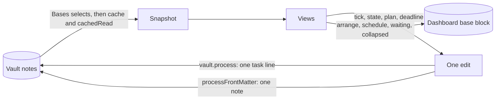
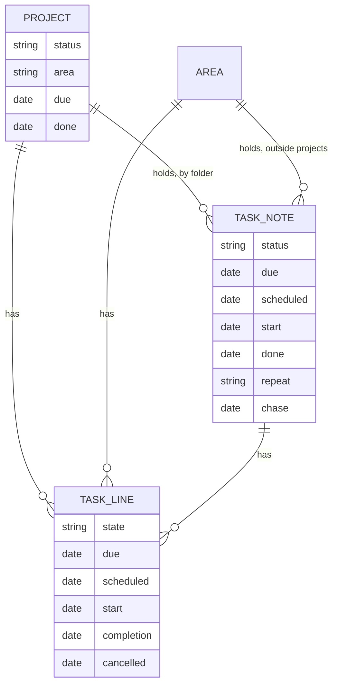

# Database

> Last updated: 19 October 2026

## Overview

Ninja Board has no database. The vault's notes are the data. Ninja Board reads each note's frontmatter from Obsidian's metadata cache, and the text of its task lines, draws the views from them, and keeps nothing between draws. Every change it makes is one small edit to one note or one line.

The only state Ninja Board saves is layout: a board's order, the Schedule's form, Waiting's view and the stories folded in the Week view, on every week. All of them live in the dashboard note's `base` block (see [Dashboard notes](#dashboard-notes)).

The note format is set by the implementation spec. Its [reference format](https://alexsendula.github.io/second-brain/implementation/) (section 2) defines the fields, the value formats and the task-line format. The **Edits** table in the same section defines every change Ninja Board may make. This page says what Ninja Board reads and writes as built in v1.1.0.

## Data flow



The snapshot is built per draw from the notes Bases selected ([obsidian/snapshot.ts](../src/obsidian/snapshot.ts)). Notes under `10 Archive/` are dropped there and again in [model/snapshot.ts](../src/model/snapshot.ts).

## Note types

Ninja Board reads a note's `type` to decide what it is. A missing or unknown `type` reads as `other`, which no view draws ([model/snapshot.ts](../src/model/snapshot.ts), `NOTE_TYPES`).

| `type` | Drawn as | Frontmatter Ninja Board reads |
|---|---|---|
| `task` | A story card (a task note in a project's folder), or a task note outside a project, whose open lines count on Today, Week and Backlog | `status`, `due`, `scheduled`, `start`, `done`, `repeat`, `repeat_from`, `if_missed`, `chase`, `waiting_on`, `points`, `lead`, `created` |
| `project` | A card on Projects. Its task lines count on Week, Projects and Backlog | `status`, `area`, `due`, `done`, `created` |
| `area` | A group under No date on Backlog and in To plan on Week. Its task lines count on Week, and so do the open lines of a task note in its folder | none beyond `type`; the notes in its folder belong to it |
| `appointment` | Today's Schedule and the Week strip | `date`, `repeat`, `time`, `where` |
| `inbox` | Backlog's inbox, with its age. Any note in `02 Inbox` counts too, whatever its `type` | `received`, else the date and time at the start of its name, else `created` |
| `week-plan` | A past week's record. Read by its path (`08 Weeks/...`), not by `type` | `updated`, `frozen`, and the record's sections in the body |

Notes of the types `commitment`, `conversation`, `person` and `people` are recognised, but no view selects them. The agent uses them.

Ninja Board reads no other frontmatter field. The spec's fields that only the agent uses, such as `length`, `with`, `calendar`, `estimate`, `context`, `source` and `birthday`, pass through untouched. `repeat_from` and `if_missed` are read only when a repeating note is completed (see [Repeating task notes](#repeating-task-notes)).

Details that matter when reading the data:

- **Status values.** A task note's `status` is `open`, `doing`, `waiting`, `someday`, `done` or `dropped`. Ninja Board shows `open` as to do, the same as a line's `[ ]`. A project's `status` is `active`, `paused`, `someday`, `done` or `dropped`.
- **Membership is by folder.** A note belongs to the closest project folder above it. Outside every project, it belongs to the closest area folder ([model/snapshot.ts](../src/model/snapshot.ts), `assignParents`). Two notes with the same name are kept apart by their folders.
- **Which task lines count.** Lines in project, area and task notes can be drawn as tasks. A line in any other note (an appointment, an inbox item, a week plan) is never drawn as one. A story's lines, that is, the lines of a task note in a project's folder, are the steps of its card. On the Week board and in its counts, a project's lines count only while the project is active. Backlog's waiting list also counts paused projects ([model/week.ts](../src/model/week.ts), `eligibleNotes`).
- **Dates.** A date is `YYYY-MM-DD`, or a datetime that starts with one. A value that is not a real date (such as `2026-02-30`) is ignored ([model/dates.ts](../src/model/dates.ts), `toISO`).
- **Appointment times.** `time` is `HH:MM` or `HH:MM-HH:MM`. Ninja Board splits the range on `-` or `–`. A repeat of `every tue`, `every mon, thu` or `every mon-fri` shows on each of its days from `date` on. Other repeats show only on `date` ([model/appointments.ts](../src/model/appointments.ts)).
- **Titles.** An appointment's title is its file name, without a leading `YYYY-MM-DD `.



## Task lines

Task lines use the Tasks plugin's Dataview format, and the [Tasks setup](ENVIRONMENT.md#obsidian-and-plugins) is required for ticking. Ninja Board reads a line only when Obsidian's metadata cache lists it as a task. So a `- [ ]` inside a code block or an HTML comment is not a task ([obsidian/snapshot.ts](../src/obsidian/snapshot.ts), `rawNote`).

A line starts with `-`, `*` or `+`, any indentation, then a checkbox and its text ([taskLine.ts](../src/model/taskLine.ts), `TASK_RE`, line 9).

| Checkbox | State | Tasks' status type | Ninja Board writes it |
|---|---|---|---|
| `[ ]` | to do | TODO | when reopening a line, or setting to do from a card |
| `[/]` | doing | IN_PROGRESS | from a card |
| `[w]` | waiting | ON_HOLD (a custom status) | from a card. `scheduled` is then the chase date |
| `[x]` | done | DONE | never directly: ticking goes through Tasks, which adds `completion` |
| `[-]` | dropped | CANCELLED | from a card, with a `cancelled` date |

An unknown checkbox symbol reads as to do.

Fields are in square brackets, or in parentheses, and Ninja Board reads these five ([taskLine.ts](../src/model/taskLine.ts), `FIELD_RE`, line 16):

| Field | Meaning |
|---|---|
| `[due:: YYYY-MM-DD]` | The deadline. Shown in red as "Due". |
| `[scheduled:: YYYY-MM-DD]` | The planned day. For a waiting line, the chase date. |
| `[start:: YYYY-MM-DD]` | Planned for that week, any day. The value is that week's Monday. |
| `[completion:: YYYY-MM-DD]` | When it was done. Tasks writes it when the line is ticked. |
| `[cancelled:: YYYY-MM-DD]` | When it was dropped. Ninja Board writes it when the line is dropped, and removes it on reopen. |

Other fields stay in the title text. A title drops fields, link brackets and tags, and `[[Name|Alias]]` shows as `Alias`.

When Ninja Board writes:

- It keeps the brackets of a field it replaces. It adds a new field as `[key:: value]`, after one space, before any block id (`^abc`), which stays last ([taskLine.ts](../src/model/taskLine.ts), `withField`).
- Tasks writes its own completion line, with two spaces before each field. The spec's **Edits** table shows that shape next to Ninja Board's.
- A pointer line, whose text is only one wikilink, such as `- [ ] [[Choose hosting for Sam's site]]`, points to a story. Ninja Board shows the story and not the line.

The edits Ninja Board makes are the rows of the spec's [Edits table](https://alexsendula.github.io/second-brain/implementation/). In summary:

- **State** (lines): start, wait, drop and reopen. Tick and done go through Tasks.
- **Plan** (lines and notes): a day sets `scheduled` and removes `start`. A week sets `start` and removes `scheduled`. No date yet removes both. A `due` that the plan leaves behind goes too, except a repeating note's. The rule is one function, `planDropsDue` ([model/plan.ts](../src/model/plan.ts), line 12).
- **Deadline** (lines and notes): sets or removes `due`. Setting a deadline removes a `scheduled` on that same day.
- **Notes**: a note's `status` and `done`, and its `scheduled`, `start` and `due` keys, follow the same rules as the lines.

A repeating task note keeps its `due` whatever the plan ([src/model/plan.ts](../src/model/plan.ts), `repeats`). Its completion is the one state change that also writes a Log line; see [Repeating task notes](#repeating-task-notes).

## Repeating task notes

A task note with a `repeat` key is a repeating note. Completing it writes two things, and dropping it writes one:

- **The frontmatter.** `status` becomes `open` and `due` becomes the next date. `scheduled`, `start`, `waiting_on`, `chase` and `done` are removed ([src/model/repeat.ts](../src/model/repeat.ts), `applyNoteComplete`).
- **The Log line.** One line at the top of the note's first `## Log` section, under its heading:

  ```markdown
  ## Log
  - 2026-10-20 Done: the occurrence due 2026-10-16. Next due 2027-04-20.
  ```

  The line is `- <day done> Done: the occurrence due <due>. Next due <next>.`, with the dates as `YYYY-MM-DD`. Ninja Board reads only lines of that form, and only in the first `## Log` section, from its heading to the next heading ([occurrencesIn](../src/model/repeat.ts)). A note with no `## Log` section gets one at its end, with the line under it ([withLogEntry](../src/model/repeat.ts)).
- **Dropping** writes `status: dropped` and `done` (today, kept if already set). It writes no Log line.

A completed occurrence is a Done row in the week of its day. The note itself is on the board only in the week of its next `due`.

The repeats Ninja Board reads are `every <n> day`, `week`, `month` or `year` (with an optional `s`, as in `every month` or `every 6 months`), and `every <weekdays>` (`every tue`, `every mon, wed, fri`, `every mon-fri`). `repeat_from` is `due` (the default: the next date counts from the due date being completed) or `done` (from the day it was done). `if_missed` is `carry` (the default: a missed date stays due) or `lapse` (a missed date is skipped). A month end drifts, since each step counts from the due date being completed.

## Week plans and records

A week plan is `08 Weeks/<year>/<YYYY-Www>.md`. The year is the ISO week's year ([record.ts](../src/model/record.ts), `weekPlanPath`, line 51).

- Ninja Board reads a week plan only when a past week is shown. It never writes one. The current and upcoming weeks come from the notes.
- A record is five `### ` sections, in this order: `Appointments`, `Done`, `In progress`, `Not done` and `Backlog`. All five must be there, or the week falls back to what the notes say now ([record.ts](../src/model/record.ts), `parseWeekRecord`, line 33).
- An item is a plain list item, never a checkbox: `- <title> · <context>`. Its fields come after, in square brackets, where they apply: `[day:: date]`, `[time:: HH:MM]` or `HH:MM-HH:MM`, `[due:: date]`, `[moved:: date]` and `[dropped:: date]`. The title is what comes before the last ` · `.
- The plan's `frozen` and `updated` dates are shown above the record, as "Record · frozen Mon 12 Oct".
- Its frontmatter may hold `points_planned` and `points_done`, the week's planned and done story points. Ninja Board reads them only when both are numbers, for a past week, read-only and marked as the record. Without them the week shows no points figure.
- On a past week, `Appointments` feed the strip as they were that week. The board's columns are `Not done`, `In progress` and `Done`. `Backlog` is a tile under them, folded under its count. A line whose context names a story (a task note in a project, or another item the record lists) is grouped under that story as a card, in the column of the story's own row, else of its first line, with its lines as read-only rows under its title. A Backlog item whose context is `Inbox` shows as an inbox item, with a dot ([src/model/past.ts](../src/model/past.ts), `recordWeek`).

The record is specified in the [round-2 design, section 5](design/2026-10-14-brain-plugin-round-2-design.md). A sample is `sample-vault/08 Weeks/2026/2026-W41.md`.

## Dashboard notes

`01 Dashboard/` holds one note per view: `01 Today.md`, `02 Week.md`, `03 Projects.md`, `04 Backlog.md` and `05 Guide.md`. Each note holds a single `base` block. Bases selects the dashboard notes like any other note, but their `type: note` reads as `other`, so no view draws them ([sample-vault/01 Dashboard/02 Week.md](../sample-vault/01%20Dashboard/02%20Week.md)). The keys below are read through Bases' view config, and Bases writes them back into the block.

| Key | Where | Value | Read by |
|---|---|---|---|
| `filters` | Top level | A Bases filter. The sample excludes `10 Archive` and anything that is not `.md`. Ninja Board shows the notes it selects. | Bases |
| `views[].type` | Each view | `ninja-board-today`, `ninja-board-week`, `ninja-board-projects`, `ninja-board-backlog` or `ninja-board-guide` | Bases, and Ninja Board's registration ([main.ts](../src/main.ts), `VIEWS`) |
| `views[].name` | Each view | The name in the view picker | Bases |
| `views[].arrange` | The Week and Projects notes | A map from column to a list of item keys. Week: `todo`, `doing`, `waiting`. Projects: `active`, `paused`, `someday`. | [arrange.ts](../src/model/arrange.ts), `readArrangement` |
| `views[].collapsed` | The Week note | A list of story names: the stories folded in the Week view, on every week, each by its note's name, listed once. Absent, or anything that is not a list, means none. A name stays listed after its story leaves the week. | [arrange.ts](../src/model/arrange.ts), `readCollapsed` |
| `views[].schedule` | The Today note | `compact`. Absent, or any other value, means large. | [arrange.ts](../src/model/arrange.ts), `readScheduleView` |
| `views[].waiting` | The Week note | `group`. Absent, or any other value, means the column view. | [arrange.ts](../src/model/arrange.ts), `waitingViewOf` |

An example for the Week board:

```yaml
views:
  - type: ninja-board-week
    name: Week
    arrange:
      todo: [Order cabinets, "Home › Clean the gutters"]
    collapsed: [Order cabinets]
```

- **Item keys.** A card, or a row that is a task note, is keyed by its note's name. A line is keyed `<note name> › <text as shown>`, where the separator is U+203A with a space either side ([arrange.ts](../src/model/arrange.ts), `ARRANGE_SEPARATOR`, `lineKey`). The text has its fields, link brackets and tags removed.
- **Order.** Keys that are listed come first, in the listed order. A key with no item on the board is ignored, and the next save drops it.
- **Saving.** Bases writes the whole `base` block back each time, so its formatting and comments are normalised. Ninja Board saves only where Bases can write the block: the dashboard note itself, not an embed, a hover or a canvas ([edits.ts](../src/obsidian/edits.ts), `arrangementPersists`). The README covers what happens elsewhere.
- **Grouping and sorting.** Ninja Board ignores Bases' own grouping and sorting, and keeps its own order.

## Other data Ninja Board reads

- **Tasks' settings.** The Guide's setup check reads the Tasks plugin's saved settings, through the plugin's `loadData()`. It uses two values: `taskFormat`, which must be `dataview`, and `statusSettings.customStatuses`, which must hold a status with symbol `w` and type `ON_HOLD` ([model/guide.ts](../src/model/guide.ts), `buildGuide`). Ninja Board never writes Tasks' settings.
- **Tasks' API.** Ticking a line calls Tasks' `apiV1.executeToggleTaskDoneCommand(line, path)`, which returns the new line text ([writes.ts](../src/obsidian/writes.ts), `toggleViaTasks`).
- **The config note.** `99 System/config.md` holds the vault's contexts and add-ons, and `points_per_week`, the week's points target (8 when absent). Ninja Board reads its frontmatter from the metadata cache, and a change to the note redraws the views.

## Notes on the data

- **No schema version or migrations.** Ninja Board has no format version and no migration step.
- **No backups by Ninja Board.** An edit is one line or one frontmatter key. Ninja Board's own Undo lasts for the Obsidian session only. For older changes the vault's own history is the undo: Obsidian's File recovery core plugin, and the vault's git where it has one (the implementation spec, section 1).

## Related Documentation

- [Security](SECURITY.md): what Ninja Board may write, and how each write is checked
- [Environment](ENVIRONMENT.md): the Tasks setup and the sample vault
- [Troubleshooting](TROUBLESHOOTING.md): why a line or a card doesn't show
