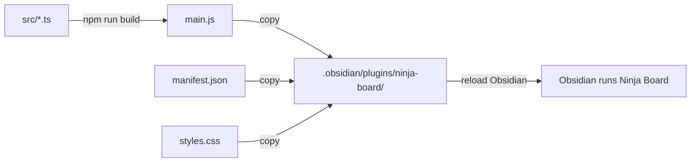

# Deployment

> Last updated: 17 October 2026 (Ninja Board v1.0.1)

## Overview

Ninja Board is not in a store. [package.json](../package.json) is marked `"private": true`. A release is built and attested by the release workflow when a version tag is pushed ([Release](#release)). To use Ninja Board by hand, you build `main.js` and copy three files into a vault's `.obsidian/plugins/ninja-board/` folder. You do that by hand, or with `npm run sandbox`. Then you reload Obsidian.

## Targets

| Target | What happens | Command |
|---|---|---|
| The sandbox vault | Builds, then copies the three files. With `--yes`, it also resets the notes to the sample vault | `npm run sandbox`, or `npm run sandbox -- --yes` |
| Another vault | You copy the three files by hand | See [Install into a vault](#install-into-a-vault) |
| A release | Linted, tested, built and attested by the release workflow, then published as a GitHub release | Push a tag equal to the manifest's version; see [Release](#release) |
| The browser preview | Not a deployment. It runs the real views on the sample vault | `npm run preview`; see [Preview](#preview) |

The vault installer that the plugin design describes (`install.py`, for new vaults) is not in this repository yet ([plugin design, section 5](design/2026-10-13-brain-plugin-design.md)).

## Prerequisites

- Node 24 or newer, and `npm install` run once in the repository root.
- Obsidian 1.10.2 or newer, with Bases turned on and Tasks set up. See [Environment](ENVIRONMENT.md#obsidian-and-plugins).
- For the sandbox: `BRAIN_VAULT` set to the sandbox vault. The folder must have an `.obsidian` folder, or the script stops.

## Build

Run these from the repository root:

```bash
npm install     # once
npm run build   # writes main.js in production mode
```



- `npm run build` runs esbuild once in production mode. It writes `main.js` with no source map. The config does not minify it ([esbuild.config.mjs](../esbuild.config.mjs)).
- `main.js` is a build output, and git ignores it ([.gitignore](../.gitignore)). `manifest.json` and `styles.css` are tracked. Together with `main.js` they are the whole plugin ([plugin README](../README.md)).
- `npm run dev` rebuilds `main.js` on every save, with inline source maps. It doesn't copy anything into a vault. Run `npm run sandbox`, or copy by hand, to see the change in Obsidian.

## Install into a vault

By hand:

1. Run `npm run build` in the repository root.
2. Create `<vault>/.obsidian/plugins/ninja-board/` if it doesn't exist.
3. Copy `main.js`, `manifest.json` and `styles.css` into that folder, over the old copies. Ninja Board writes no file of its own there, so these three are the whole update.
4. Reload Obsidian (Cmd+R) if Ninja Board doesn't pick up the change. The README asks for a reload after each new build.

With the sandbox script:

- `npm run sandbox` builds, copies the three files into `BRAIN_VAULT`, and lists the notes a reset would move. It moves nothing. The notes stay as they are.
- `npm run sandbox -- --yes` does the same, and then moves every item in the vault's top folder whose name doesn't start with a dot to the Trash, and copies `sample-vault/` in. Dot-items such as `.obsidian` stay ([sandbox.mjs](../scripts/sandbox.mjs), lines 29 to 53).
- With `--yes`, the script also prints the next steps: turn Ninja Board on, set the Tasks options, open `01 Dashboard/01 Today`, and make it the start page.

The reset never deletes. It renames each item into `~/.Trash/brain-sandbox-<date>-<time>/`, which it creates without `recursive`. A second reset in the same second fails there, rather than overwriting the first run's notes. The sandbox test runs with `HOME` pointing at a temporary folder, so the real Trash is never touched ([sandbox.test.ts](../test/sandbox.test.ts), lines 16 and 29).

## Versioning

- **Versions so far:** v0.1.0 (round 1, built 14 October 2026) v0.2.0 (round 2, built 15 October 2026), v1.0.0 (16 October 2026) and v1.0.1 (17 October 2026). The status line of the [plugin design](design/2026-10-13-brain-plugin-design.md) records the first two.
- **Where the version lives.** Change all four in the same commit:
  1. [manifest.json](../manifest.json): `version`.
  2. [package.json](../package.json): `version`.
  3. [package-lock.json](../package-lock.json): two places, the top-level `version` and the `version` under the `""` package.
  4. [versions.json](../versions.json): a new entry, the version mapped to the minimum Obsidian version it needs.
- **`minAppVersion`** changes only when the code needs a newer Obsidian. Then it changes in `manifest.json`, and `versions.json` gets an entry for the new version.
- **Tags.** The release workflow needs a tag equal to the manifest's version, with no `v` (`1.0.1`, not `v1.0.1`). No Ninja Board version tag exists yet.

## Before a build goes into a vault

Run these from the repository root:

- `npm run lint`: ESLint with Obsidian's review rules, over `src` and `preview`. It must report nothing.
- `npm test`: the Node test runner, over `src/**/*.test.ts` and `test/**/*.test.ts`.
- `npm run typecheck`: `tsc --noEmit`.
- `npm run build`: the production build must succeed.

Then the checks the design asks for:

- Look at the views in the preview, in light and dark, at several widths ([plugin design, section 5](design/2026-10-13-brain-plugin-design.md)). The preview compares each view's markup with `design/mockup.html`.
- Make a final check in the sandbox vault, in Obsidian.

`test/styles.test.ts` fails if `styles.css` drifts from the mockup's `#brain-css` block. The two allowed differences are the `.brain-view` scoping of every rule and the note-context reset. The preview and mockup checks are manual. The only workflow is the release workflow, which runs when a tag is pushed.

## Release

The release workflow, [`.github/workflows/release.yml`](../.github/workflows/release.yml), runs when a tag is pushed:

1. It checks that the tag equals `manifest.json`'s `version`, so the tag is `1.0.1`, not `v1.0.1`.
2. On macOS with Node 24, it runs `npm ci`, `npm run lint`, `npm test` and `npm run build`.
3. It attests `main.js`, `manifest.json` and `styles.css` with `actions/attest-build-provenance`, so `gh attestation verify` can check each file against this workflow run.
4. It creates the GitHub release with those three files. The notes are the CHANGELOG section for the version, read from `docs/CHANGELOG.md`. If the version has no section there, the notes are the default line `Ninja Board <tag>.`.

GitHub runs a workflow only from the `.github/workflows` folder at the root of a repository. This repository's root is the plugin, so the workflow runs from here.

## Preview

- `npm run preview` runs `scripts/sample-json.mjs`, which writes `preview/sample.json`. Then it builds `preview/dist/preview.js`, and serves the plugin with `node scripts/serve.mjs` on 127.0.0.1:8766. The server uses Node's standard library only, answers only to the Host names `127.0.0.1:8766` and `localhost:8766`, and serves files under this repository only.
- Open http://localhost:8766/preview/. The root address returns 404: the server does not list folders.
- The preview runs the real renderers on the sample vault. Its writes happen in memory, so a reload brings the sample back. Opening a note shows a line of text, "Opens …", where Obsidian would open the note ([preview.ts](../preview/preview.ts), `say`).
- Stop the server with Ctrl+C.

## Rollback

Each release keeps its three files on GitHub, so to go back, copy that release's `main.js`, `manifest.json` and `styles.css` into the vault. Without a release, check out the earlier commit, run `npm run build`, and copy the three files into the vault again. Ninja Board keeps no data of its own, so a rollback changes only the code the vault runs.

## Related Documentation

- [Environment](ENVIRONMENT.md): requirements, and the plugin's files
- [Security](SECURITY.md): what the sandbox script can move, and what the plugin writes
- [Troubleshooting](TROUBLESHOOTING.md): the preview, the sandbox script and the Notices
