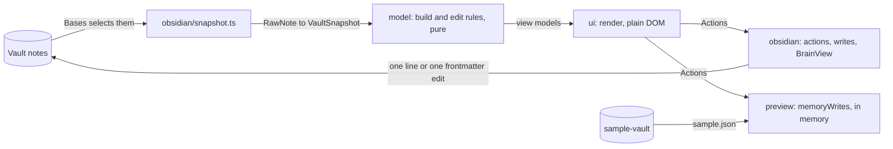

# Developer guide

> Last updated: 17 October 2026 (Ninja Board v1.0.1)

This guide covers working on Ninja Board, the Obsidian plugin in this repository: setup, the commands, where the code lives, the preview and the sandbox, commits, and the spec rules. For how the parts fit together, read [Architecture](./ARCHITECTURE.md). For tests, read [Testing](./TESTING.md). For code style, read [Style guide](./STYLE_GUIDE.md). Users read the [plugin README](../README.md).

## Setup

You need:

- **Node 24 or newer.** The tests and scripts run the `.ts` sources directly, with Node's type stripping. `engines` in `package.json` is `>=24`. The test run for this guide, on 17 October 2026, used Node v24.14.0.
- **Obsidian 1.10.2 or newer** to try the plugin. The Bases core plugin must be on, and the Tasks community plugin installed. The [README's requirements](../README.md#requirements) say how to set Tasks up.

From the repository root:

```bash
npm install   # once; reads package-lock.json
npm test
```

The dev dependencies are TypeScript 5.9.3, esbuild 0.28.2, linkedom 0.18.13 (the DOM for the UI tests), yaml 2.9.1, `@types/node` 24.19.2 `obsidian` 1.14.4, ESLint 9.39.5 with `eslint-plugin-obsidianmd` 0.4.2 and `typescript-eslint` 8.71.2 (for `npm run lint`). The `obsidian` package ships types only. esbuild leaves `obsidian` out of the bundle, and Obsidian supplies it when the plugin runs.

## Commands

Run them from the repository root.

| Command | What it does |
|---|---|
| `npm test` | Runs every `src/**/*.test.ts` and `test/**/*.test.ts` with Node's test runner, with `test/obsidian-hook.mjs` loaded first. A few seconds. See [Testing](./TESTING.md). |
| `npm run typecheck` | Runs `tsc --noEmit` over `src`, `test` and `preview`. The test runner does not check types, so run both. |
| `npm run lint` | Runs ESLint with Obsidian's review rules (`eslint-plugin-obsidianmd`) over `src` and `preview`. It must report nothing. Its `prelint` step rewrites `preview/sample.json`. |
| `npm run build` | Builds `main.js` once, for production: a CommonJS bundle with no source map. |
| `npm run dev` | Watches `src/main.ts` and rebuilds `main.js` on each change, with inline source maps. It does not rebuild the preview. |
| `npm run preview` | Writes `preview/sample.json` from the sample vault, builds the preview bundle once, and serves the plugin on 127.0.0.1:8766. Open `http://localhost:8766/preview/`. |
| `node esbuild.config.mjs preview` | Rebuilds `preview/dist/preview.js` alone. `npm run preview` does this too, once, at start. |
| `npm run sandbox` | Builds, then installs Ninja Board into the sandbox vault. Changes no notes. See [The sandbox](#the-sandbox). |
| `npm run sandbox -- --yes` | As above, and also resets the vault's notes to the sample notes. |

`npm test` runs `sandbox.test.ts` too, and that test runs `npm run build`, so a test run rewrites `main.js`. The build outputs are gitignored: `main.js`, `preview/dist/` and `preview/sample.json` (see [`.gitignore`](../.gitignore)).

The plugin is three files: `main.js`, `manifest.json` and `styles.css`. [`manifest.json`](../manifest.json) gives version 1.0.1, `minAppVersion` 1.10.2 and `isDesktopOnly: false`. [`versions.json`](../versions.json) maps each version to its minimum Obsidian version.

## Where the code lives



| Folder | What it holds | May import |
|---|---|---|
| [`src/model/`](../src/model/) | Pure code: task lines, dates and ISO weeks, the snapshot, each view's model (the `build*` functions), the planning rules, arrangements and the week record. | Model files only. |
| [`src/ui/`](../src/ui/) | Plain DOM: the `render*` functions, the cards, drag and focus, and the `Actions` interface in [`src/ui/actions.ts`](../src/ui/actions.ts). | Model and UI files. Nothing from Obsidian. |
| [`src/obsidian/`](../src/obsidian/) | The Obsidian side: [`view.ts`](../src/obsidian/view.ts) (BrainView, the Bases view), [`src/obsidian/actions.ts`](../src/obsidian/actions.ts) and [`writes.ts`](../src/obsidian/writes.ts) (the real writes), the modals and the Guide's note. [`edits.ts`](../src/obsidian/edits.ts) holds the pure edit rules. | Anything. |
| [`src/main.ts`](../src/main.ts) | The plugin class. Registers the five view types and the two commands. | |
| [`preview/`](../preview/) | The browser preview. [`preview.ts`](../preview/preview.ts) draws the real views from `sample.json`; [`memoryWrites.ts`](../preview/memoryWrites.ts) makes the writes in memory; `modal.ts` holds the modals; `tokens.ts` supports `checkView()`. | Model and UI files, and `obsidian/edits.ts`: the in-memory writes share the same edit rules as the vault. |
| [`test/`](../test/) | Shared test helpers ([`sample.ts`](../test/sample.ts), [`ui.ts`](../test/ui.ts)), the edit examples ([`edit-cases.json`](../test/edit-cases.json)), and the tests that cross layers. | |
| [`scripts/`](../scripts/) | [`sample-json.mjs`](../scripts/sample-json.mjs) writes `preview/sample.json`. [`sandbox.mjs`](../scripts/sandbox.mjs) installs into the sandbox vault. | |
| [`design/`](../design/) | [`mockup.html`](../design/mockup.html), the visual and DOM contract. | |
| [`styles.css`](../styles.css) | The plugin's stylesheet: the mockup's `#brain-css` block, scoped under `.brain-view`. | |
| [`sample-vault/`](../sample-vault/) | The sample notes. The only sample data, for the tests, the preview and the sandbox. | |

Four rules decide where code goes:

- **The model reads no clock and no DOM.** The caller passes `today` as `YYYY-MM-DD` and the time of day as `HH:MM`. See [`dates.ts`](../src/model/dates.ts) and [`clock.ts`](../src/ui/clock.ts).
- **The UI never imports from `src/obsidian/`.** Its only route to a write is the `Actions` interface. The Obsidian layer and the preview each implement it.
- **Only `src/obsidian/` and `src/main.ts` import `obsidian`.** Under Node, `test/obsidian-hook.mjs` resolves that import to `test/obsidian-stub.ts`, a stand-in with only what the tested code uses. Files that import it load in the tests, and the modal classes and `main.ts` have no tests of their own (see [Testing](./TESTING.md)).
- **Ninja Board keeps no data of its own.** A write is one small edit to one note: a line, or the frontmatter. An arrangement, and the Schedule's view, are saved in the dashboard note's `base` block. The agent's `brain` commands make the same edits. [Architecture](./ARCHITECTURE.md) has the read and write paths.

## Changing Ninja Board

- **What a view shows.** Change the model's `build*` function in `src/model/`, then the `render*` function in `src/ui/`. Give each a test.
- **What a click writes.** Start with the rule in `src/obsidian/edits.ts`, and add its examples to `test/edit-cases.json`. Then make the write in `src/obsidian/writes.ts`, and its in-memory twin in `preview/memoryWrites.ts`. The agent's `brain` command must make the same edit. The `brain` commands are specified in the implementation spec and are not in this repository (see [Architecture](./ARCHITECTURE.md)).
- **How it looks.** Change the mockup first: `design/mockup.html`, its `#brain-css` block. Then copy the rule into `styles.css` under `.brain-view`. `test/styles.test.ts` fails if the two drift. For the busy-day work, the mockup and `styles.css` changed together, and the code followed.
- **Styles and the DOM.** Write no element style directly. A fixed value goes to a class in `styles.css`; a value computed at run time goes through `setCssProps` or `setCssStyles`, which Obsidian gives every HTML and SVG element. `styles.css` uses no `:has`, `!important`, `clip-path`, multicolumn or `display: contents`, and no source uses a lookbehind regex (iOS before 16.4 has none). `test/styles.test.ts` checks these, and `npm run lint` checks Obsidian's other rules.
- **A new view type.** Add its id to `BrainViewType` and to `DRAW` in `src/obsidian/view.ts`, to `VIEWS` in `src/main.ts`, and to the `View` type and `VIEWS` in `preview/preview.ts`. Add a dashboard note for it under `sample-vault/01 Dashboard/`.

For a feature that spans these layers, the round-2 work went roughly in this order:

1. Decide it in a spec first. A new choice goes in the implementation spec, or in Ninja Board's own round spec. If it seems to need a change to the system, propose that; do not edit the system spec.
2. Build the model and the UI, each with tests.
3. Check it in the preview, then run `await checkView()` against the mockup.
4. Run `npm test` and `npm run typecheck`.
5. The author checks it by hand in the sandbox vault.
6. Update the README and the spec's as-built notes to match the behaviour, then commit.

## Working with the preview

- Run `npm run preview` and open `http://localhost:8766/preview/`. The preview is the real model and the real UI on `sample-vault/`. A bar at the top switches views and the mockup's states.
- The clock is fixed. Today is 13 October 2026, and the time is 11:10 (`TODAY` and `NOW` in `preview/preview.ts`), so the Schedule's now-line reads the same on every visit.
- Writes (tick, state, plan, deadline, arrange) change the notes in memory only. Reload the page to get the sample back.
- After a change under `src/` or `preview/`, run `node esbuild.config.mjs preview` and reload. The preview bundle is built once, not watched. After a change to `sample-vault/`, run `npm run preview` again, because it rewrites `sample.json`.
- To compare the page with the mockup, run `await checkView()` in the browser console. See [Testing](./TESTING.md#checking-the-preview-against-the-mockup).

## The sandbox

The sandbox is a real Obsidian vault that Ninja Board is installed into.

- **`BRAIN_VAULT`** names the sandbox vault. When it is unset, the script uses `~/Documents/Obsidian Vault`. The folder must contain `.obsidian`. Otherwise the script stops before it changes anything.
- **`npm run sandbox`** builds Ninja Board and copies `main.js`, `manifest.json` and `styles.css` into `<vault>/.obsidian/plugins/ninja-board/`. It changes no notes. It lists the notes a reset would move.
- **`npm run sandbox -- --yes`** does the same, then resets the notes. Every entry at the top of the vault except dotfiles moves to `~/.Trash/brain-sandbox-<YYYYMMDD-HHMMSS>/`, so `.obsidian` stays. Then `sample-vault/` is copied in. The old notes stay in the Trash until someone empties it.
- **In Obsidian, after a run:** turn Ninja Board on under Settings → Community plugins (reload with Cmd+R if it is not listed). Set the Tasks settings the script prints: Task Format Dataview, and a custom status `w`, named Waiting, next status `x`, type ON_HOLD. Open `01 Dashboard/01 Today`. Reload with Cmd+R after each new build.
- **Coding agents do not run it.** Development rules bar agents from running `npm run sandbox`, `scripts/sandbox.mjs`, or anything with `BRAIN_VAULT` set, because the reset replaces the sandbox's notes. The author runs it. `test/sandbox.test.ts` runs the script only in temporary folders, with HOME pointed at a temporary home, so `npm test` is safe.
- **Another vault.** Copy `main.js`, `manifest.json` and `styles.css` into that vault's `.obsidian/plugins/ninja-board/`.

## Commits

Subjects start with an area and a colon, then say what changed, in lower case, with no full stop.

- **Body.** Plain prose, wrapped at about 80 columns. It says why, and names the spec section behind a choice. For example, a commit that makes a moved task drop its deadline names the rule in `planDropsDue`.

## Releasing

A release is a version tag. Set `version` in `manifest.json`, `package.json` and `package-lock.json`, and add the entry to `versions.json`, all in one commit. Then push a tag equal to that version, with no `v` (`1.0.1`). The release workflow in `.github/workflows/release.yml` does the rest: it checks the tag, runs the lint, the tests and the build, attests `main.js`, `manifest.json` and `styles.css`, and creates the GitHub release. [Deployment](./DEPLOYMENT.md#release) has the details.

## Specs

The plugin's design specs are in [`docs/design/`](design/). The system design and the implementation spec are published on the [framework site](https://alexsendula.github.io/second-brain/). The system design is frozen as version `system-v1`: it changes only by an explicit decision, recorded in its own change log.

## Common problems

- **"Bases is off. Turn it on, then reload this plugin."** (a Notice at start). Turn on Bases, then reload Ninja Board. The message is in `src/main.ts`.
- **"Tasks must be on to tick a task".** Tasks is off or not installed. The views still draw, but a tick shows this Notice and writes nothing ([`writes.ts`](../src/obsidian/writes.ts)).
- **"Tasks gave an answer this plugin can't use".** Ninja Board checks Tasks' answer before it writes. When the answer is not usable, Ninja Board writes nothing and shows this Notice.
- **The preview says `sample.json: HTTP <status>`.** The file is missing. Run `npm run preview`, which writes it.
- **A change does not show in Obsidian.** Reload Obsidian with Cmd+R after the build. The sandbox run does this for the plugin files it copies.
- **A change does not show in the preview.** Rebuild the preview bundle with `node esbuild.config.mjs preview`, then reload.
- **An arrangement, or the Schedule's view, does not stick.** Bases saves a base block only in the note itself (Reading view or Live Preview) or in a `.base` file. In an embed, a hover preview or a canvas, Ninja Board shows a Notice and does not save. Open the dashboard note itself (`01 Dashboard/01 Today.md`, `02 Week.md` or `03 Projects.md`) to arrange or switch there.
