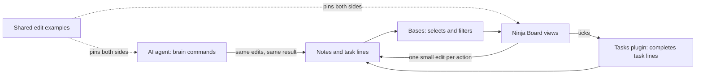

# Project Overview

> Last updated: 20 October 2026

## What is Ninja Board?

Ninja Board is an Obsidian plugin that shows a second-brain vault as five views: Today, Week, Projects, Backlog & Waiting and Guide. Bases chooses which notes a view covers, and Ninja Board draws them. In a view you can tick a task, set its state, move a card, plan a task, set a deadline, arrange a board and open the note behind anything. Each of these is one small edit to one note, written straight back. Ninja Board keeps no data of its own.

Ninja Board is the human side of a personal second brain. The AI agent does the rest: creating, most planning, repeats, archiving and week records. The code is in this repository, and the user guide is [`README.md`](../README.md).

## Who it is for

The author, AlexSendula, keeps a personal second brain in an Obsidian vault and works on it with an AI agent. It was built for the author's own vault first. The repository is public, so others can read the code and install it. The package is still marked `"private": true` in [`package.json`](../package.json), so it is not published to npm. The implementation spec says others can use the system as a template for their own.

## The five views

| View | Dashboard note | What it shows |
|---|---|---|
| Today (`ninja-board-today`) | `01 Dashboard/01 Today.md`, which can be the start page | The date with a ring. **Now:** tasks in doing. **Today:** due or planned today, a plan missed on an earlier day (still open, showing its day), overdue, and waiting tasks whose chase date has come. **Schedule:** today's appointments, in Large or Compact. **Done today:** collapsed. |
| Week (`ninja-board-week`) | `02 Week.md` | The ISO week and a strip of seven days. A board with To do, Doing, Waiting and Done (Waiting can be a group inside Doing). Paging through weeks, Coming up, Plan this week with To plan, and a read-only record for past weeks. |
| Projects (`ninja-board-projects`) | `03 Projects.md` | A board by status: Active, Paused, Someday and Done. |
| Backlog & Waiting (`ninja-board-backlog`) | `04 Backlog.md` | The inbox with the age of each item, undated tasks, someday projects, and one tile per person you are waiting on. |
| Guide (`ninja-board-guide`) | `05 Guide.md` | What the marks mean, how to do things by mouse, touch or keyboard, how to plan, the time words, who does what, and a live check of the Tasks setup. |

Each dashboard note holds one `base` block. The block's filters choose the notes, and Ninja Board keeps its own order.

## Key features

- **Tick and set states.** Click the circle or press Space. Right-click, long-press or Shift+F10 opens a card with the five states. Ticks go through the Tasks plugin, so one engine writes the completion date.
- **Move and arrange.** Drag a card or row to another column. On the Week and Projects boards, drop it at a place, or use Alt+↑ and Alt+↓. The order is saved in the dashboard note.
- **Plan and set deadlines.** A task can go on a day, into a week at any day, or back to no date yet. The planner card also sets and removes a deadline.
- **Weeks.** ‹ and › page through weeks. Coming up lists the next three. A past week reads from its record, or from the notes when there is no record.
- **Busy days.** Large, the default, shows about six hours of the day and scrolls. Compact fits the whole day into the same height. The Week strip shows only the appointments still to come, with "+N more" for the rest.
- **Long lists.** Projects' Done shows the three most recent projects and Someday the five most recent. Show all opens a searchable list, and an item can be dragged out of it onto the board.

The full rules, and the planner card's steps, are in the [plugin README](../README.md).

## How the human and the agent split the work

| In Ninja Board | With the agent |
|---|---|
| Tick, set a state, move, arrange, open | Create tasks, notes and appointments |
| Plan a task on a day or for a week, repeating notes too; set or remove a deadline | Most planning |
| | Week plans and records, archiving, and anything that needs date math |

### The parity rule

Anything you can do in Ninja Board, the agent can do with the same result. Every edit Ninja Board makes is one of the fixed rules in the Edits table of the [implementation spec](https://alexsendula.github.io/second-brain/implementation/), and the agent makes the same edits with `brain` commands. [`test/edit-cases.json`](../test/edit-cases.json) holds the shared examples that pin both sides to the same results.

## Business rules

| Rule | What it means | Where it lives |
|---|---|---|
| Ninja Board keeps no data of its own | Each view is drawn from the notes, and every change is one small edit to one note | [Plugin README](../README.md) |
| Almost no date math | Ninja Board puts dates into words such as "Due Thu" and "3 days overdue". Its one step of its own is a repeating note's next due date, when an occurrence completes. Carry-over and other repeats belong to the agent. | [Plugin README](../README.md) |
| Tasks completes task lines | A tick calls Tasks' own toggle command, so there is one completion engine | [`writes.ts`](../src/obsidian/writes.ts) |
| The archive is skipped | Notes under `10 Archive/` are left out of the snapshot | [`src/model/snapshot.ts`](../src/model/snapshot.ts) |
| A new plan replaces the old one | A day plan clears `start`, a week plan clears `scheduled`, and no date yet clears both | [`applyNotePlan`](../src/model/plan.ts) |
| A deadline the plan leaves behind goes | A day or week in a later ISO week than the `due` removes it. No date yet removes a `due` on or before this week's Sunday. | [`planDropsDue`](../src/model/plan.ts) |
| Repeating task notes complete in Ninja Board | A tick, or a drop on Done, completes one occurrence: Ninja Board writes the next due date and a line in the note's Log. They plan like task notes: their plan decides their week, and their deadline counts only without a plan. | [Plugin README](../README.md) |

## Integrations and requirements

| Service | Purpose | Documentation |
|---|---|---|
| Obsidian 1.10.2 or newer | The host app. Ninja Board uses the Bases view API (`registerBasesView`). It is tested on desktop. It is not marked desktop-only, but the phone app has not been tried. | [Plugin README, Requirements](../README.md#requirements) |
| Bases core plugin | Selects the notes that each view draws | [Plugin README, Requirements](../README.md#requirements) |
| Tasks community plugin | Task line format (Dataview), the completion engine, and a custom `w` status for Waiting (ON_HOLD). The Guide's Setup check reads its saved settings. | [Plugin README, Requirements](../README.md#requirements) |
| Node.js 24 or newer | Development only: the tests, the typecheck and the esbuild build | [Plugin README, Developing](../README.md#developing) |

## Status

- **Started:** 13 October 2026, when the design was written. The first code was committed on 14 October 2026.
- **Version:** 1.1.1 in `manifest.json`, `package.json` and `versions.json`. v0.1.0 was built on 14 October 2026, v0.2.0 on 15 October 2026, v1.0.0 on 16 October 2026, v1.0.1 on 17 October 2026, v1.0.2 on 17 October 2026, v1.0.3 on 18 October 2026, v1.0.4 on 18 October 2026, v1.1.0 on 19 October 2026, and v1.1.1 on 20 October 2026.
- **Stage:** Ninja Board 1.1.1 is the current release. Its changes are listed under 1.1.1 in the [changelog](CHANGELOG.md), dated 20 October 2026.
- **Not built yet:** the agent's `brain` commands. The implementation spec defines them, and the shared edit examples pin the edits they must make, but this repository holds no `brain` code.
- **Release:** Ninja Board 1.1.1 is the latest release, tagged `1.1.1`. From 1.0.1 on, the release workflow builds, attests and publishes each release.

## Related documentation

- [Plugin README](../README.md): install, use and the rules.
- [Plugin design spec](design/2026-10-13-brain-plugin-design.md): the goals, the views and the first design.
- [Round 2 design](design/2026-10-14-brain-plugin-round-2-design.md): what v0.2.0 added, and the rulings made while building it (section 10).
- [Implementation spec](https://alexsendula.github.io/second-brain/implementation/): the file format and the Edits table.
- [System spec](https://alexsendula.github.io/second-brain/system-design/): the system, frozen as `system-v1`.
- [Changelog](CHANGELOG.md): what changed in each version.
